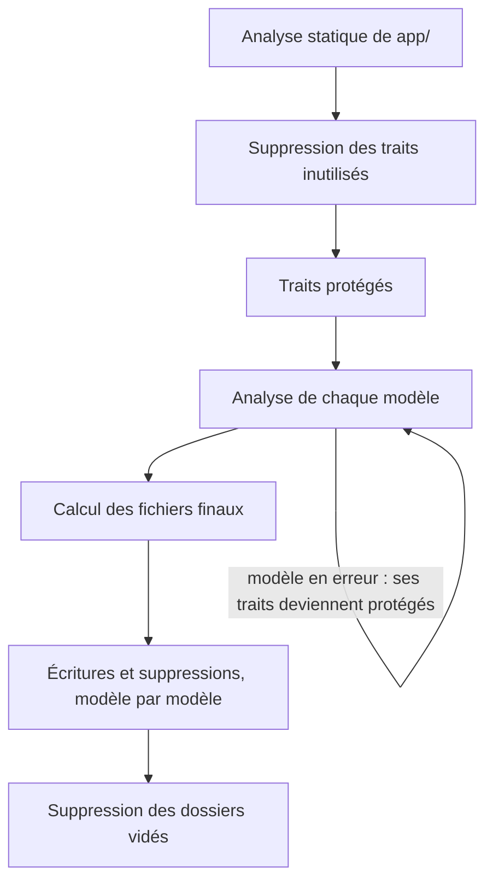

Architecture
============

Le package se compose d’un service provider et d’une commande Artisan, qui s’appuie sur la réflexion PHP et sur nikic/php-parser.

ServiceProvider
---------------

`Axn\ModelsOrganizer\ServiceProvider` fusionne la configuration `models-organizer` et, en environnement local et en console uniquement :

- enregistre la commande `models:organize` ;
- publie le fichier de configuration via `vendor:publish --tag=models-organizer-config`.

Déroulé de la commande
----------------------

`Axn\ModelsOrganizer\Console\OrganizeModelsCommand` analyse tout avant d’écrire quoi que ce soit, pour qu’un fichier modifié pour un modèle ne fausse jamais l’analyse d’un autre.



### Analyse statique de `app/`

Chaque fichier PHP de `app/` est lu par php-parser, noms résolus, sans charger de classe : la commande relève chaque classe, enum et trait, avec les traits qu’il utilise. Un fichier qui ne peut pas être analysé arrête la commande avant toute modification.

Les traits de `app/Models` qu’aucune classe ni aucun enum n’atteint, directement ou par un autre trait, et qui ne figurent pas dans `ignored_traits`, sont alors supprimés.

### Traits protégés

La commande ne parcourt ni ne modifie :

- les traits de `ignored_traits` ;
- les traits utilisés par une classe ou un enum de `app/` autre que les modèles traités ;
- les traits d’un modèle dont l’analyse a échoué ;
- et, pour chacun, les traits qu’il utilise.

### Analyse des modèles

Pour chaque modèle, la commande établit un plan : méthodes classées (relations, scopes, attributes), contenu des traits à générer, lignes à retirer des fichiers sources, traits sources à réexaminer.

Les fichiers sont lus une seule fois et gardés en mémoire tels qu’au lancement. Les lignes d’une méthode sont délimitées par php-parser : la méthode avec ses attributs, et les commentaires collés au-dessus d’elle qui commencent leur ligne.

Si l’analyse d’un modèle échoue, ses traits deviennent protégés et l’analyse de tous les modèles reprend : un autre modèle ne peut plus vider un trait que le modèle en erreur partage.

### Calcul des fichiers finaux

Les lignes à retirer sont cumulées par fichier, sur son contenu d’origine : un trait partagé est vidé une seule fois, après que chaque modèle en a reçu sa copie.

Un trait est supprimé s’il ne contient plus ni méthode, ni propriété, ni constante, et que les traits qu’il utilise sont eux-mêmes supprimés ; le calcul se répète jusqu’à ce que plus aucun trait ne s’ajoute. Les `use` des traits supprimés sont ensuite retirés des fichiers conservés, d’après le nom résolu du trait (alias compris).

### Écritures

Pour chaque modèle, dans l’ordre : traits générés, traits sources (rattachés au premier modèle qui les utilise), puis fichier du modèle, avec l’import et le `use` des traits générés. Un fichier n’est écrit que si son contenu change.

Les dossiers vidés de `app/Models` sont calculés d’après les écritures et suppressions de la commande. En simulation (`--dry-run`), le même calcul a lieu sans rien écrire : la sortie annonce ce que ferait l’exécution réelle.

Tests
-----

La suite (Pest, Testbench) monte pour chaque test une application jetable dans un dossier temporaire, désigné comme `app_path()`, lance la commande, puis vérifie le résultat dans un processus séparé : `php -l` sur chaque fichier, et méthodes de chaque classe relevées par réflexion avant et après.

```bash
composer test
```
